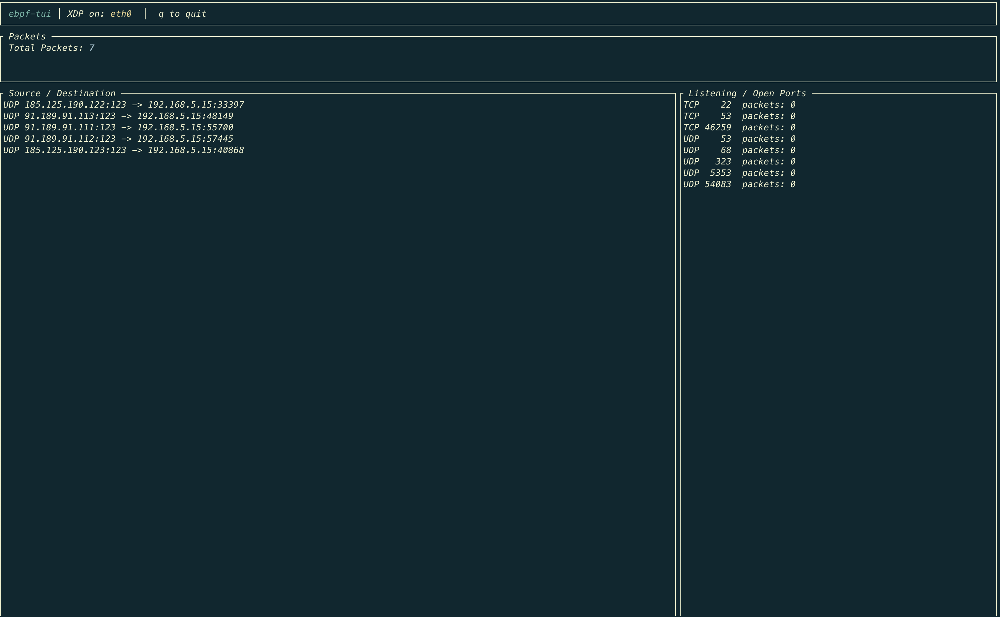

# ebpf-tui

## Demo



## Prerequisites
Install `limactl`

#### Running on macOS using Lima

Install Lima with Homebrew:
```shell
brew install limactl
```

Start the default VM or create an Ubuntu instance:
```shell
limactl create --name=ubuntu template://ubuntu
```

Open a shell inside the VM:
```shell
limactl shell <instance-name>
```

Inside the VM, install the system dependencies:
```shell
sudo apt update

sudo apt install -y rustup net-tools build-essential pkg-config libssl-dev
```

Install the nightly Rust toolchain and BPF target:
```shell
rustup toolchain install nightly --component rust-src

rustup target add bpfel-unknown-none --toolchain nightly

# Install bpf-linker
cargo install bpf-linker
```

## Build & Run

The application and its embedded eBPF program run on Linux. The XDP program attaches to the
selected interface and passes packets on to the normal network stack. The dashboard shows the
total packet count, recent IPv4/IPv6 source and destination addresses, and TCP/UDP ports. Its
open-ports panel reads listening TCP sockets and bound UDP sockets from `/proc/net`; it refreshes
periodically and counts observed packets whose source or destination port matches one of them.
The eBPF ring buffer requires Linux 5.8 or newer.

Build the user-space application (this also builds and embeds the eBPF program):

```shell
cargo +nightly build --package ebpf-tui

# List available network interfaces:
ifconfig -a

# Run the debug binary as root, replacing eth0 with your interface:
sudo ./target/debug/ebpf-tui --iface eth0
```

To build a release binary instead, use `cargo +nightly build --release --package ebpf-tui`
and run `sudo ./target/release/ebpf-tui --iface eth0`.

## License

With the exception of eBPF code, ebpf-tui is distributed under the terms
of either the [MIT license] or the [Apache License] (version 2.0), at your
option.

Unless you explicitly state otherwise, any contribution intentionally submitted
for inclusion in this crate by you, as defined in the Apache-2.0 license, shall
be dual licensed as above, without any additional terms or conditions.

### eBPF

All eBPF code is distributed under either the terms of the
[GNU General Public License, Version 2] or the [MIT license], at your
option.

Unless you explicitly state otherwise, any contribution intentionally submitted
for inclusion in this project by you, as defined in the GPL-2 license, shall be
dual licensed as above, without any additional terms or conditions.

[Apache license]: LICENSE-APACHE
[MIT license]: LICENSE-MIT
[GNU General Public License, Version 2]: LICENSE-GPL2
